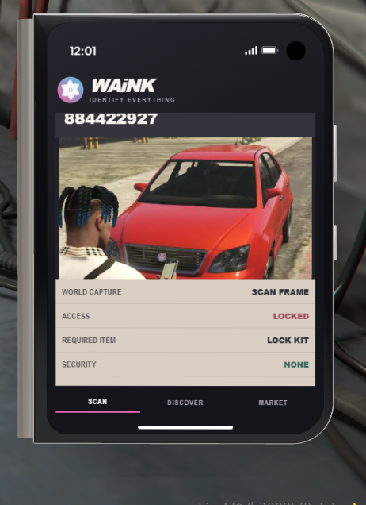
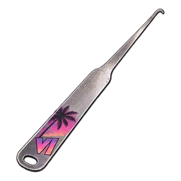
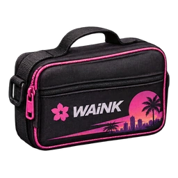
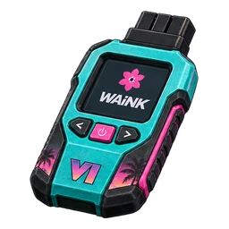
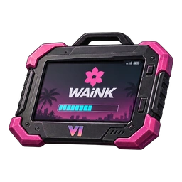
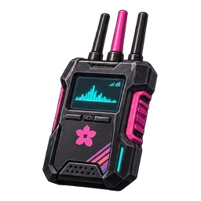

# WAiNK — WHIP Edition

**CookieLabs · v1.12.5 · FiveM / WHIP**

A GTA VI-inspired vehicle scanner and fictional street-vehicle gameplay resource for WHIP. WAiNK runs inside the original WHIP Duo phone, with a live game-world preview, vehicle identification, native skill games and a configurable NPC dealer.



*In-game screenshot supplied by CookieLabs.*

## Features

- Original WHIP Duo app integration, including the WAiNK-inspired logo and scan, discover and market tabs.
- First-person vehicle scanning with a live WebGL game-view preview, target lock and captured result image. Supports parked and moving vehicles.
- Vehicle lock status, fictional security and tracker tiers, required inventory item, estimated resale value and registration price.
- Native WHIP skill games for all five inventory tools; adjustable Lock Kit timer (18 seconds by default).
- A native WHIP conversation with Moses, the vehicle dealer: request a quote, sell or register an eligible vehicle and confirm the transaction.
- WHIP inventory registration with five individual WebP item images, native map blips and `/whip` settings.
- Server-side vehicle eligibility, ownership and transaction checks. Moving vehicles are identification-only until parked and empty. Player-owned vehicles are excluded from the sale and registration flow.
- No boosting contracts, separate phone UI or ox_lib dependency.

## Requirements

- FiveM GTA V server with OneSync enabled.
- [WHIP Core](https://github.com/WHIPFX/whip_core) with external settings, inventory, native skill checks (including inline ring levels), NPC conversations, vehicle records and server-managed blips.
- [WHIP Phone](https://github.com/WHIPFX/whip_phone), original Duo interface. The supplied aiming bridge targets version 1.1.0; other versions/forks require a compatibility review.
- Keep the phone's built-in `skillcheck` module enabled.

## Installation

1. Download or clone this repository. Name the resource directory **`whip_waink`** and place it in your server's resources directory.
2. Back up `whip_phone`. If it does not already contain the WAiNK aiming bridge, follow [Phone integration — required export](docs/PHONE-INTEGRATION.md). The bridge is included as a small patch, not a replacement phone.
3. Add the following in `server.cfg`, after your database and WHIP prerequisites:

   ```cfg
   ensure whip_core
   ensure whip_phone
   ensure whip_waink
   ```

4. Restart the server. Open your original WHIP phone; WAiNK registers automatically.
5. In `/whip` → Settings → WAiNK, review the dealer, gameplay and eligibility settings. In `/whip` → Economy → Items, grant or stock the five items below. No extra core skill-game preset or SQL import is required.

> **Already using the V1.6+ WAiNK phone bridge?** Do not apply it twice. Just install this resource. No core config edits are required for the Lock Kit timer.

## Phone integration: `SetWainkAim`

Stock WHIP Phone 1.1.0 needs the camera input bridge in `whip_phone/client/main.lua`. It temporarily releases the phone's camera input block while keeping the original NUI phone visible, and restores it on completion or cancellation. The bridge includes `SetWainkAim`, the `wainkPoll` NUI callback and cleanup hooks. Adding only the export name is not sufficient.

[Full installation instructions and manual code](docs/PHONE-INTEGRATION.md) · [Download the exact 1.1.0 patch](docs/phone-bridge/whip_phone-1.1.0.patch)

## Inventory items

| Image | Item | Inventory ID | Native skill game |
| --- | --- | --- | --- |
|  | Slim Jim | `waink_slimjim` | Ring |
|  | Lock Kit | `waink_lockkit` | Ring (18 s default) |
|  | Key Cloner | `waink_keycloner` | Override |
|  | Advanced Key Cloner | `waink_procloner` | Brute Force |
|  | Signal Tool | `waink_signaltool` | Reroute |

Images are automatically registered by the resource. If an old image remains, check the saved picture override in WHIP's item editor. The Slim Jim uses the versioned `waink_slimjim_vi.webp` path. All tools are fictional in-game items.

## Configuration

All common settings are managed in `/whip` → Settings → WAiNK.

| Section | Controls |
| --- | --- |
| Scanner | Enabled, preview field width, FPS, scan range/time, tool range, item consumption |
| Skill games | Lock Kit timer (8–36 seconds; default 18) |
| Economy | Resale/registration percentages, cooldown, tier values |
| Vehicle eligibility | Unknown population, WHIP session and scripted vehicle compatibility |
| Vehicle models | Admin-approved civilian add-on model spawn names |
| Security | Alarm and tracker probabilities |
| Vehicle dealer | Enable, placement, interaction radius, map visibility and legend name |
| Dealer map blip | Icon, colour, scale and minimap range |
| Dealer character | Ped model, heading, height adjustment, MLO gate and character name |

**Defaults:** 24 FPS, 25 m scan range, 1000 ms scan time. Moses is enabled at `vector4(737.48, -1093.35, 22.17, 82.04)` in base-game LS Customs; the custom MLO gate is off. Saved settings override defaults. Adjust location and heading for your server through the placement controls.

## Gameplay overview

Open WAiNK and select Start Scan. Aim at an eligible GTA vehicle, allow the scan to complete, then view the results in the app. Access challenges use native WHIP skill games and the corresponding fictional inventory item. Follow the dealer waypoint and talk to Moses to receive and confirm a sale or registration quote. WHIP handles the resulting bank and vehicle ownership operations. Player-owned or otherwise protected vehicles cannot be sold or registered through WAiNK.

## Troubleshooting

| Symptom | What to check |
| --- | --- |
| Native camera unavailable | Apply the phone bridge, restart both resources and confirm the stock phone version. |
| App missing | Ensure resource name is `whip_waink`, dependencies started and WAiNK enabled. |
| Preview unavailable | FiveM game-view WebGL hook/build compatibility; scanning does not require a healthy preview heartbeat. |
| Unknown model/protected result | Check WHIP catalogue and server eligibility diagnostics; approve only known civilian add-ons. Do not disable ownership protection. |
| Dealer not visible | Enable and place the dealer; leave custom MLO gate off for vanilla interiors. Check server logs for `Dealer ready` or failed spawn attempts. |
| Incorrect map label | Verify the WHIP Core `ShowBlip`/`HideBlip` support and saved map label. |
| Lock Kit missing difficulty | Use v1.12.5 and a core supporting inline ring levels. No named `waink_lockkit` preset is required. |

## Known limitations and testing

- The live preview samples the GTA viewport, not an independent rear camera; some FiveM builds may not support its WebGL hook.
- Session history and access profiles are not persistent. WHIP handles registered vehicle persistence.
- Unmarked rentals and other third-party vehicle systems may need explicit compatibility checks. See [eligibility and testing notes](docs/RELEASE-HISTORY.md). Test player-owned vehicles, rentals and protected cars before deploying on a public economy.
- Sale deletion and payment are separate WHIP operations; reconcile any logged payment failure. Registration refunds on detected eligibility/claim failure.
- Performance is designed around active scanning only; no fixed FPS or resmon figure is guaranteed.
- This package is a documentation/distribution refresh of v1.12.5, not a gameplay rewrite. Live testing against each server's installed WHIP version remains necessary.

## Credits and distribution

Created by **CookieLabs** for the WHIP community. WHIP and its original Duo phone are by Whippy / WHIPFX. GTA, Grand Theft Auto and related branding belong to their respective owners. This is an unofficial fan-inspired FiveM resource, not affiliated with Rockstar Games. Item artwork is original GTA VI-inspired artwork, not extracted game assets.

The WHIP-derived phone patch retains the upstream LGPL-3.0 licence; see [patch notice](docs/phone-bridge/NOTICE.md). No licence for the independent WAiNK resource has been selected in this package. Repository owner: choose distribution/licensing terms before making the repository public.

See [changelog](CHANGELOG.md) for release history.
